  

  

 

I build agent evaluation platforms, RL environments and full-stack products. Currently going deep on post-training and physical AI.

### Selected work

| Project | What it is |
| --- | --- |
| [agentforge](https://github.com/Sivadheeraj5356/agentforge) | Agent bench and grader: Horizon v1 catalog, hidden verifiers, Next.js control plane, isolated evaluator |
| [quizsift](https://github.com/Sivadheeraj5356/quizsift) | Free scored quiz builder: lead qualification and product recommendation quizzes, shareable by link |
| [kyra-openloop-triage](https://github.com/Sivadheeraj5356/kyra-openloop-triage) | Offline, deterministic triage for message threads: replies you owe, promises you made, unclosed scheduling |
| [answerthis-citation-atlas](https://github.com/Sivadheeraj5356/answerthis-citation-atlas) | Citation graph explorer for any paper: ranked OpenAlex search + interactive graph (FastAPI + Next.js) |
| [vela-scheduler-bench](https://github.com/Sivadheeraj5356/vela-scheduler-bench) | Verifiable eval environment for scheduling agents: timezone math, multi-party constraints, staged graders |
| [gnani-voice-ops-line](https://github.com/Sivadheeraj5356/gnani-voice-ops-line) | Hinglish voice reporting line for field ops crews, built for the Great Indian AI Internship Challenge |

### Stack

   
  

### Numbers

  
  

  

  <picture>
    <source media="(prefers-color-scheme: dark)" srcset="https://raw.githubusercontent.com/Sivadheeraj5356/Sivadheeraj5356/output/github-contribution-grid-snake-dark.svg" />
    <source media="(prefers-color-scheme: light)" srcset="https://raw.githubusercontent.com/Sivadheeraj5356/Sivadheeraj5356/output/github-contribution-grid-snake.svg" />
    
  </picture>

### Elsewhere

  
  
  

  

<!-- Credits: readme-typing-svg (DenverCoder1), skillicons.dev, anuraghazra/github-readme-stats, DenverCoder1/github-readme-streak-stats, Platane/snk (MIT) - snake regenerated daily via .github/workflows/snake.yml. assets/hero.svg and assets/footer.svg are original hand-built animated SVGs for this profile. -->
